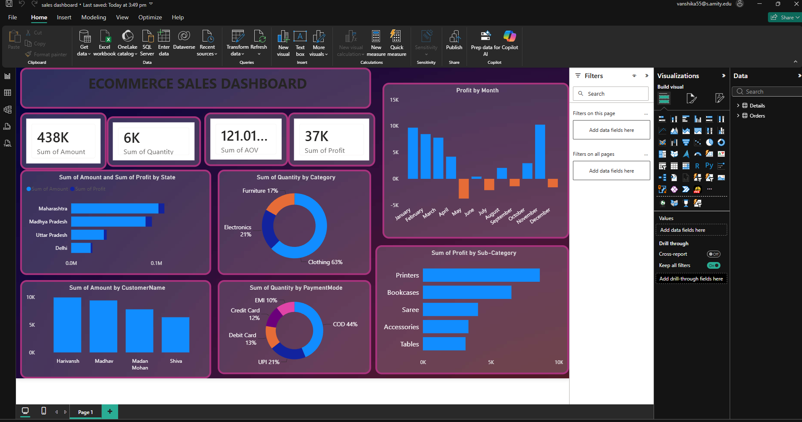

#  Ecommerce Sales Dashboard | Power BI

### Interactive Sales Analytics & Business Intelligence Dashboard

An interactive **Power BI dashboard** designed to analyze ecommerce sales performance, profitability, customer purchasing behavior, and regional sales trends to support data-driven business decisions.

## Dashboard Preview



##  Project Overview

The **Ecommerce Sales Dashboard** provides a comprehensive analysis of ecommerce business performance using Microsoft Power BI.

The dashboard transforms raw sales and order data into meaningful business insights through interactive visualizations, KPI cards, and comparative charts.

It helps businesses understand:

- Overall sales and profitability
- Monthly profit trends
- Sales performance across different states
- Product category contributions
- Customer purchasing behavior
- Preferred payment methods
- Profitability of different product subcategories

##  Key Performance Indicators (KPIs)

| KPI | Dashboard Value |
|---|---|
|  Total Sales | 438K |
|  Total Quantity Sold | 6K |
|  Average Order Value (AOV) | 121.01... |
| Total Profit | 37K |

*Values are based on the dashboard preview and reflect the underlying dataset.*

##  Dashboard Visualizations

### 1. Monthly Profit Analysis

- Visualizes profit performance from January to December.
- Identifies profitable and loss-making months.
- Helps understand seasonal trends and fluctuations.

### 2. State-wise Sales Analysis

Compares sales across different Indian states, including:

- Maharashtra
- Madhya Pradesh
- Uttar Pradesh
- Delhi

**Insight:** Maharashtra shows the highest sales contribution among the displayed states.

### 3. Product Category Analysis

The dashboard displays the following approximate quantity distribution:

| Category | Contribution |
|---|---|
| Clothing | 63% |
| Electronics | 21% |
| Furniture | 17% |

**Insight:** Clothing contributes the largest share of quantity sold.

### 4. Customer-wise Sales Analysis

Compares sales amounts across individual customers to identify top customers and understand purchasing patterns.

### 5. Payment Mode Analysis

| Payment Mode | Share |
|---|---|
| Cash on Delivery (COD) | 44% |
| UPI | 21% |
| Debit Card | 13% |
| Credit Card | 12% |
| EMI | 10% |

**Insight:** Cash on Delivery is the most frequently used payment method in the displayed distribution.

### 6. Subcategory Profit Analysis

Compares profits across product subcategories, such as:

- Printers
- Bookcases
- Sarees
- Accessories
- Tables

**Insight:** Printers have the highest profit contribution among the displayed subcategories.

## 🛠️ Tools & Technologies

| Tool | Purpose |
|---|---|
| Microsoft Power BI Desktop | Dashboard development |
| Power Query | Data preparation and transformation |
| DAX | Calculated measures and KPIs |
| Data Visualization | Interactive business reporting |
| Business Intelligence | Sales performance analysis |

## Repository Structure

```text
PowerBI-Dashboard/
│
├── sales dashboard.pbix
├── dashboard-preview.png
└── README.md
```

##  How to Use This Dashboard

**Step 1:** Download or clone the repository.

```bash
git clone https://github.com/vanshi1606/PowerBI-Dashboard.git
```

**Step 2:** Install Microsoft Power BI Desktop.

**Step 3:** Open the `sales dashboard.pbix` file in Power BI Desktop.

**Step 4:** Explore the dashboard and interact with the charts and visualizations.

*Note: Refreshing the dataset may require access to the original data sources.*

## Key Business Insights

1. **Strong Sales Performance:** The dashboard reports approximately 438K in total sales.
2. **Regional Performance:** Maharashtra leads the displayed states in sales.
3. **Product Demand:** Clothing accounts for the largest quantity share.
4. **Customer Payment Preferences:** COD represents the largest payment mode share.
5. **Profit Drivers:** Printers contribute the highest profit among the displayed subcategories.
6. **Monthly Profit Variability:** Certain months record losses, suggesting opportunities for further cost and profitability analysis.

##  Project Objectives

- Monitor ecommerce sales performance.
- Identify high-performing product categories.
- Track monthly profitability.
- Analyze customer payment preferences.
- Compare regional sales.
- Support data-driven business decisions.

##  Future Improvements

- Sales forecasting using machine learning
- Year-over-year sales growth analysis
- Customer segmentation
- Dynamic date and region filters
- Advanced profitability analysis
- Power BI Service deployment

##  Author

**GitHub:** [vanshi1606](https://github.com/vanshi1606)

**Project Repository:** [PowerBI-Dashboard](https://github.com/vanshi1606/PowerBI-Dashboard)

---

⭐ If you found this project useful, consider giving the repository a star!

**Built with Microsoft Power BI | Data Analytics | Business Intelligence**
